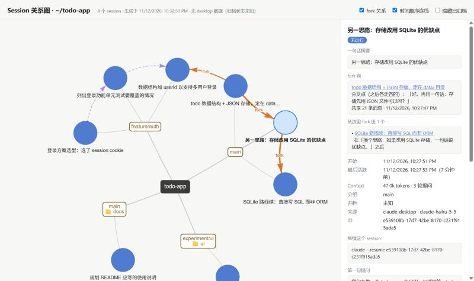

# 🕸️ session-graph

**See how your Claude Code sessions relate to each other — as an interactive graph.**

[English](#-english) · [中文](#-中文)



---

## 🇬🇧 English

### 🤔 Why

To keep context small, or to try a different idea, you split work into many Claude Code sessions. After a while it's hard to remember *which session forked from which*, *what each one was about*, and *which one to go back to*. `session-graph` is a [Claude Code skill](https://docs.claude.com/en/docs/claude-code/skills) that draws them as a map.

### ✨ Features

| | |
|---|---|
| 🍴 **Fork tree** | Detects which session was forked from which (even forks of forks), and shows the exact message where they diverged |
| 🌿 **Branch & folder groups** | Groups sessions by git branch, worktree and sub-folder |
| ⏱️ **Timeline** | Dashed arrows show the order sessions were started within a group |
| 📝 **One-line summaries** | Claude writes a short summary per session (cached, so unchanged sessions cost nothing next time) |
| 🟢 **Status** | Running / idle / archived (archived state needs the Claude desktop app) |
| 📏 **Context size** | Tokens in use per session — bigger dot = fuller context |
| 🔍 **Details on click** | First & last prompt, start / last activity, fork point, and how to resume it |
| 👀 **Read-only** | Never renames, archives or deletes anything |

### 📦 Install

Requires Python 3.8+ (standard library only) and Claude Code.

```bash
git clone REPO_URL
cp -r session-graph/session-graph ~/.claude/skills/
```

On Windows PowerShell:

```powershell
git clone REPO_URL
Copy-Item -Recurse session-graph\session-graph $HOME\.claude\skills\
```

This installs it as a **user-level skill**, available in every project.

### 🚀 Usage

Open Claude Code in your project folder and type:

```
/session-graph
```

Claude collects this project's sessions, writes the summaries, and opens the graph in your browser. The page is saved to `~/.claude/session-graph/<project>/graph.html`.

**Reading the graph:**

- 🟠 **Solid orange arrow:** original session → fork
- 🟣 **Dashed purple arrow:** the next session in time, within the same group
- 🟫 **Boxes:** the project, plus one box per git branch / folder
- 🟢 Running · 🔵 Not running · ⚪ Archived

### ⚙️ How it works

1. `scripts/session_graph.py collect` reads `~/.claude/projects/*/*.jsonl` and keeps the sessions whose working directory is your project (or inside it).
2. **Forks:** a forked transcript copies the original's messages with the same IDs. The script uses those to find each fork's closest ancestor. It decides which side is the original from which one is fully contained in the other, then from how prompt IDs are re-stamped, and finally from file creation time.
3. If the Claude desktop app's session tools are available, Claude adds titles, archived state and app links.
4. Claude writes the one-line summaries, and `render` builds a self-contained HTML page using [vis-network](https://visjs.github.io/vis-network/).

🔒 Everything stays on your machine. The only network request is the page loading vis-network from a CDN.

### 🧪 Testing

`tests/make_testbed.sh` builds a throw-away git project with 8 real sessions (branches, a worktree, and nested and sibling forks) using Haiku, at very low cost. See [TESTING.md](TESTING.md) for the checklist.

### 🚧 Limitations

- Archived state is only known for sessions in the Claude desktop app.
- Sessions started from another session with the desktop app's `start_session` are not linked yet.
- Offline, the graph can't load; the session list still works.

---

## 🇨🇳 中文

### 🤔 为什么做这个

为了控制 context，或者想试不同的思路，你会把工作拆到很多个 Claude Code session 里。时间一长，就记不清**哪个是从哪个 fork 出来的**、**每个在做什么**、**下一步该回到哪个**。`session-graph` 是一个 [Claude Code skill](https://docs.claude.com/en/docs/claude-code/skills)，它把这些 session 画成一张关系图。

### ✨ 功能

| | |
|---|---|
| 🍴 **fork 树** | 识别哪个 session 是从哪个 fork 出来的（包括多层 fork），并显示具体从哪句话之后分开 |
| 🌿 **按分支和文件夹分组** | 按 git 分支、worktree 和子文件夹分组 |
| ⏱️ **时间顺序** | 同一组内用虚线箭头标出先后顺序 |
| 📝 **一句话摘要** | Claude 为每个 session 写一句话摘要；会缓存，没有变化的 session 下次不再花 token |
| 🟢 **状态** | 运行中 / 未运行 / 已归档（归档状态需要 Claude desktop app） |
| 📏 **context 占用** | 每个 session 用了多少 token，圆点越大 context 越满 |
| 🔍 **点开看详情** | 第一句和最后一句提问、开始和最后活跃时间、分叉点、如何回到这个 session |
| 👀 **只读** | 不会改名、归档或删除任何 session |

### 📦 安装

需要 Python 3.8+（只用标准库）和 Claude Code。

```bash
git clone REPO_URL
cp -r session-graph/session-graph ~/.claude/skills/
```

Windows PowerShell：

```powershell
git clone REPO_URL
Copy-Item -Recurse session-graph\session-graph $HOME\.claude\skills\
```

这样会装成**用户级 skill**，所有项目都能用。

### 🚀 使用

在你的项目文件夹里打开 Claude Code，输入：

```
/session-graph
```

Claude 会收集这个项目的 session、写摘要，然后在浏览器里打开关系图。网页保存在 `~/.claude/session-graph/<项目>/graph.html`。

**怎么看图：**

- 🟠 **橙色实线箭头**：原 session → fork 出来的 session
- 🟣 **紫色虚线箭头**：同一组里时间上的下一个 session
- 🟫 **方框**：项目本身，以及每个 git 分支或文件夹
- 🟢 运行中 · 🔵 未运行 · ⚪ 已归档

### ⚙️ 原理

1. `scripts/session_graph.py collect` 读取 `~/.claude/projects/*/*.jsonl`，只保留工作目录是这个项目（或在项目里面）的 session。
2. **fork**：fork 出来的记录会原样复制原 session 的消息，消息 ID 不变。脚本据此找到每个 fork 最近的上一层。判断哪边是原 session 时，先看谁被对方完整包含，再看 prompt ID 是否被统一改写，最后看文件创建时间。
3. 如果能用 Claude desktop app 的 session 工具，Claude 会补上标题、归档状态和 app 链接。
4. Claude 写一句话摘要，`render` 用 [vis-network](https://visjs.github.io/vis-network/) 生成一个独立的 HTML 网页。

🔒 所有数据都留在你的电脑上。唯一的联网请求是网页从 CDN 加载 vis-network。

### 🧪 测试

`tests/make_testbed.sh` 会用 Haiku 建一个临时的 git 项目，里面有 8 个真实的 session（多个分支、一个 worktree、多层 fork 和兄弟 fork），花费很少。检查清单见 [TESTING.md](TESTING.md)。

### 🚧 已知限制

- 只有 Claude desktop app 里的 session 才能知道是否已归档。
- 在 desktop app 里用 `start_session` 从另一个 session 启动的子 session，还没有连线。
- 断网时图无法加载，但 session 列表仍然可用。
