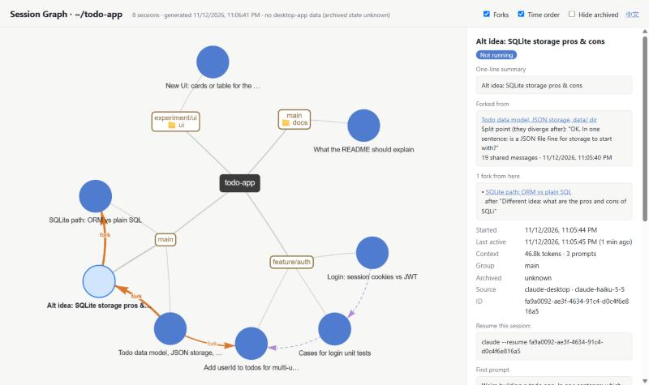

# 🕸️ session-graph

**用一张交互式关系图，看清你的 Claude Code session 之间的关系。**

[🇬🇧 English](README.md) · **中文**



---

## 🤔 为什么做这个

为了控制 context，或者想试不同的思路，你会把工作拆到很多个 Claude Code session 里。时间一长，就记不清**哪个是从哪个 fork 出来的**、**每个在做什么**、**下一步该回到哪个**。`session-graph` 是一个 [Claude Code skill](https://docs.claude.com/en/docs/claude-code/skills)，它把这些 session 画成一张关系图。

## ✨ 功能

| | |
|---|---|
| 🍴 **fork 树** | 识别哪个 session 是从哪个 fork 出来的（包括多层 fork），并显示具体从哪句话之后分开 |
| 🌿 **按分支和文件夹分组** | 按 git 分支、worktree 和子文件夹分组 |
| ⏱️ **时间顺序** | 同一组内用虚线箭头标出先后顺序 |
| 📝 **一句话摘要** | Claude 为每个 session 写一句话摘要；会缓存，没有变化的 session 下次不再花 token |
| 🟢 **状态** | 运行中 / 未运行 / 已归档（归档状态需要 Claude desktop app） |
| 📏 **context 占用** | 每个 session 用了多少 token，圆点越大 context 越满 |
| 🔍 **点开看详情** | 第一句和最后一句提问、开始和最后活跃时间、分叉点、如何回到这个 session |
| 🌐 **中英文界面** | 网页默认英文；点右上角"中文"切换，或用 `--lang zh` 生成中文版 |
| 👀 **只读** | 不会改名、归档或删除任何 session |

## 📦 安装

需要 Python 3.8+（只用标准库）和 Claude Code。

```bash
git clone https://github.com/Leoyang158/session-graph.git
cp -r session-graph/session-graph ~/.claude/skills/
```

Windows PowerShell：

```powershell
git clone https://github.com/Leoyang158/session-graph.git
Copy-Item -Recurse session-graph\session-graph $HOME\.claude\skills\
```

这样会装成**用户级 skill**，所有项目都能用。

## 🚀 使用

在你的项目文件夹里打开 Claude Code，输入：

```
/session-graph
```

Claude 会收集这个项目的 session、写摘要，然后在浏览器里打开关系图。网页保存在 `~/.claude/session-graph/<项目>/graph.html`。

**怎么看图：**

- 🟠 **橙色实线箭头**：原 session → fork 出来的 session
- 🟣 **紫色虚线箭头**：同一组里时间上的下一个 session
- 🟫 **方框**：项目本身，以及每个 git 分支或文件夹
- 🟢 运行中 · 🔵 未运行 · ⚪ 已归档

## ⚙️ 原理

1. `scripts/session_graph.py collect` 读取 `~/.claude/projects/*/*.jsonl`，只保留工作目录是这个项目（或在项目里面）的 session。
2. **fork**：fork 出来的记录会原样复制原 session 的消息，消息 ID 不变。脚本据此找到每个 fork 最近的上一层。判断哪边是原 session 时，先看谁被对方完整包含，再看 prompt ID 是否被统一改写，最后看文件创建时间。
3. 如果能用 Claude desktop app 的 session 工具，Claude 会补上标题、归档状态和 app 链接。
4. Claude 写一句话摘要，`render` 用 [vis-network](https://visjs.github.io/vis-network/) 生成一个独立的 HTML 网页。

🔒 所有数据都留在你的电脑上。唯一的联网请求是网页从 CDN 加载 vis-network。

## 🧪 测试

`tests/make_testbed.sh` 会用 Haiku 建一个临时的 git 项目，里面有 8 个真实的 session（多个分支、一个 worktree、多层 fork 和兄弟 fork），花费很少。检查清单见 [TESTING.md](TESTING.md)。

## 🚧 已知限制

- 只有 Claude desktop app 里的 session 才能知道是否已归档。
- 在 desktop app 里用 `start_session` 从另一个 session 启动的子 session，还没有连线。
- 断网时图无法加载，但 session 列表仍然可用。
